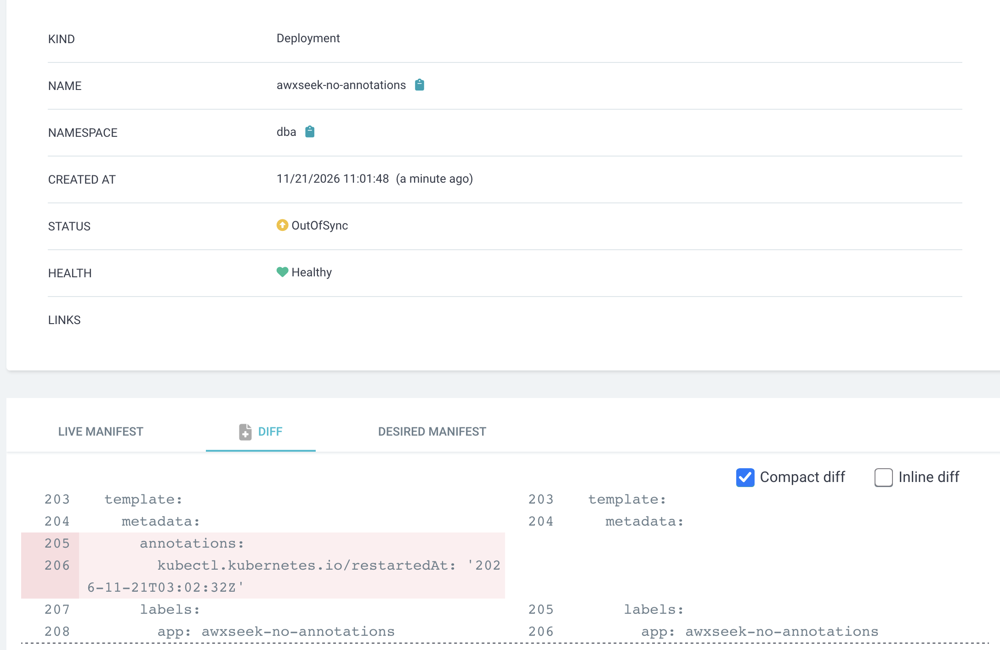

我们有时候需要在不更新应用版本的情况下 restart 应用：例如给节点加 taint 或者 cordon 节点，把 Pod 从该节点上移走；调整节点池（修改 IP CIDR 段、更换机器型号等）的时候也会遇到。我们可以在 ArgoCD 的 Web UI 上 restart 一个 Deployment 或者 StatefulSet，也可以在终端执行命令：

```bash
kubectl -n <namespace> rollout restart {deployment|statefulset} <name>
```

多数情况下，restart 都能符合预期地工作。但少数应用却无法完成整个 restart 过程：例如我遇到过 etcd 的 StatefulSet 只完成了 1 个 Pod 的 restart，其余 Pod 就不再继续；external-dns 的 Deployment 和 splunk-otel-collector 的 cluster-receiver Deployment 也有类似情况。

## 从 Restart 的原理找原因

上面提到的两种方式，背后的原理都是往 `spec.template.metadata.annotations` 添加 `kubectl.kubernetes.io/restartedAt` 这个 annotation：

```yaml
apiVersion: apps/v1
kind: Deployment
metadata:
  name: awxseek
  namespace: dba
spec:
  template:
    metadata:
      annotations:
        kubectl.kubernetes.io/restartedAt: '2026-11-20T14:48:58Z'
    # skip other fields ...
```

仔细对比这些 restart 没有达到预期的应用与其他应用，可以发现问题出在 Pod template 的 `annotations` 上：这些应用的 `spec.template.metadata.annotations` 为空。

当 Git 中的 `annotations` 为空时，添加 `restartedAt` 相当于把这个字段的类型从 null 改成了 map。开启 Self Heal 的情况下，ArgoCD 检测到 OutOfSync 就会执行同步，合并算法认为这里出现了不该存在的内容，于是尝试把 `annotations` 整个改回 null。restart 进行到一半，`restartedAt` 就被移除，Pod template 随之恢复原样，剩下的 Pod 与当前 template 保持一致，不会再被更新，整个 restart 也就无法完成。

反过来，如果 template 中的 `annotations` 不为空，`restartedAt` 只是 map 里多出来的一个外部 key，ArgoCD 的合并算法会忽略它，restart 就能正常完成。

## 短期 Workaround

短期的 Workaround 是给 ArgoCD 的 Application 加上 Sync Window（或者暂时关闭 Self Heal），让 ArgoCD 停止修改 OutOfSync 的资源。通过这个方式，也能非常直观地观察到上述变化：



截图里 Live Manifest（左侧红色部分）带着 restart 生成的 `restartedAt` annotation，而 Desired Manifest 里并没有这段内容——一旦 ArgoCD 恢复同步，就会把它移除。

这个方式的缺点是：移除 Sync Window（或者重新开启 Self Heal）之后，ArgoCD 会再次把 `restartedAt` 移除，Pod template 随之又变化一次，应用等于又被 restart 了一遍。

## 长期解决方案

我尝试过多个办法，目前看起来最简单且可靠的仍然是确保 template 中的 `annotations` 不为空。很多 Helm chart 提供了 `podAnnotations` 字段，加一条 annotation 即可：

```yaml
# values.yaml
podAnnotations:
  berryfl.asia/placeholder: "true"
```

## 小结

排查 restart 不起作用的过程让我了解到，这是 restart 机制和 ArgoCD 共同作用的结果。工作中的多数应用不会出现这种情况，因为很多需求本来就需要添加 annotation（例如可观测性工具的采集配置、Istio sidecar 的 annotation 等），Pod template 的 `annotations` 自然不为空。只有个别应用的 Pod template `annotations` 为空，才会踩到这个坑。
